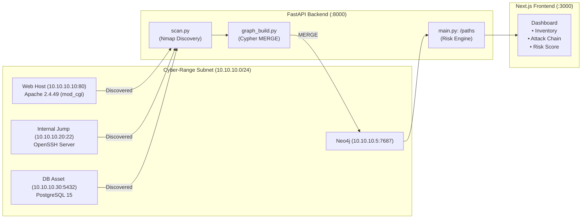

# ThreatGraph 🛡️🕸️

> **Attack Graph Risk Analysis & Multi-Stage Threat Modeling Platform**  
> *College Cybersecurity Project — 20% Vertical Slice Milestone*

ThreatGraph discovers hosts and services in a controlled cyber-range environment, correlates detected software versions against real vulnerability data (CVEs), models attack surfaces as an idempotent **Neo4j directed graph**, and computes multi-stage attack paths with numerical risk scores — moving beyond flat vulnerability lists.

---

## 📌 Project Overview & Current Milestone (20% Slice)

This repository contains the **20% vertical slice** proving the end-to-end architecture:
$$\text{Scan (Nmap)} \longrightarrow \text{Graph Ingestion (Neo4j)} \longrightarrow \text{Attack Path Resolution} \longrightarrow \text{Risk Scoring} \longrightarrow \text{Dashboard Display}$$

### What's Built in this Slice:
- **Cyber-Range Environment**: 3 target containers + Neo4j on an isolated `10.10.10.0/24` Docker bridge network.
- **Real CVE Vulnerability**: Apache HTTP Server 2.4.49 configured with `mod_cgi` for genuine **CVE-2021-41773 Remote Code Execution** (CVSS 9.8).
- **Service Discovery**: Automated Nmap scanner strictly restricted to `10.10.10.0/24`.
- **Graph Ingestion**: Idempotent Cypher `MERGE` statements creating nodes and relationships.
- **Risk Scoring Engine**: Multi-factor scoring formula incorporating CVSS, EPSS, path hops, and asset criticality.
- **Minimal Dashboard**: Next.js single-page application displaying discovered inventory, attack chain steps, and score breakdown.

---

## 🏗️ Architecture & Data Model



### Graph Schema ([docs/schema.md](docs/schema.md))
- **Nodes**: `Host`, `Service`, `Vulnerability`, `PrivilegeState`, `Asset`
- **Edges**:
  - `(:Host)-[:RUNS]->(:Service)`
  - `(:Service)-[:AFFECTED_BY]->(:Vulnerability)`
  - `(:Vulnerability)-[:EXPLOITS_TO]->(:PrivilegeState)`
  - `(:PrivilegeState)-[:PIVOTS_TO]->(:Host)`
  - `(:Host)-[:PIVOTS_TO]->(:Host)`
  - `(:Host)-[:PROTECTS]->(:Asset)`

### Risk Scoring Formula
$$\text{Score} = \left(\frac{\text{CVSS}}{10}\right) \times 40 + (\text{EPSS} \times 30) + \left(\frac{1}{\text{Path Length}}\right) \times 10 + (\text{Criticality Weight} \times 20)$$

For our verified chain ($6$ hops, CVSS $9.8$, EPSS $0.94$, Crown-Jewel $1.0$):
$$\text{Score} = (0.98 \times 40) + (0.94 \times 30) + \left(\frac{1}{6} \times 10\right) + (1.0 \times 20) = \mathbf{89.07 / 100}$$

---

## 🚀 Quick Start Guide

### 1. Prerequisites
- **Docker Desktop** (running with Linux containers enabled)
- **Python 3.10+**
- **Node.js 18+** & `npm`

---

### 2. Start the Cyber-Range & Neo4j
From the repository root:
```bash
# Copy template environment config (if needed)
cp .env.example .env

# Build and launch all 4 containers on 10.10.10.0/24
docker compose -f cyber-range/docker-compose.yml up -d --build
```

Verify containers are running:
```bash
docker ps
```
You will see:
- `threatgraph_neo4j` (`localhost:7474`, `localhost:7687`)
- `threatgraph_web_host` (`10.10.10.10:80` / `localhost:8080`)
- `threatgraph_internal_host` (`10.10.10.20:22` / `localhost:2222`)
- `threatgraph_db_asset` (`10.10.10.30:5432` / `localhost:5432`)

---

### 3. Run the FastAPI Backend
```bash
cd backend

# Create virtual environment (first time only)
python -m venv .venv

# Activate virtual environment
# Windows (PowerShell):
.venv\Scripts\Activate.ps1
# Linux / macOS:
source .venv/bin/activate

# Install dependencies
pip install -r requirements.txt

# Start FastAPI server
uvicorn app.main:app --host 0.0.0.0 --port 8000 --reload
```
- API Health: [http://localhost:8000/health](http://localhost:8000/health)
- Interactive API Docs: [http://localhost:8000/docs](http://localhost:8000/docs)

---

### 4. Run the Next.js Frontend
In a new terminal:
```bash
cd frontend

# Install dependencies (first time only)
npm install

# Start development server
npm run dev
```
Open [http://localhost:3000](http://localhost:3000) in your browser.

---

## 🧪 How to Test & Demo

1. Open the frontend dashboard at **`http://localhost:3000`**.
2. Click **"Run Discovery & Build Graph"**.
3. **Observe live results**:
   - **Discovered Inventory Table**: Shows `10.10.10.10` (Apache 2.4.49), `10.10.10.20` (OpenSSH 9.3), `10.10.10.30` (PostgreSQL).
   - **Attack Chain**: 7-node ordered sequence from external entry point to crown-jewel customer database.
   - **Risk Score**: Calculated score of **`89.07 / 100`** with component breakdowns.
4. **Neo4j Browser Exploration**:
   - Open **`http://localhost:7474`** (User: `neo4j`, Password: `threatgraphpassword`).
   - Run the Cypher query:
     ```cypher
     MATCH p=(start:Host {exposure: 'internet'})-[*1..10]->(target:Asset {criticality: 'crown-jewel'})
     RETURN p
     ```
   - View the interactive visual attack graph.

---

## 📁 Repository Structure

```text
/threatgraph
  ├── /backend
  │     ├── /app
  │     │     ├── main.py         # FastAPI routes (/health, /scan/start, /paths)
  │     │     ├── db.py           # Neo4j driver connection & Cypher runner
  │     │     ├── scan.py         # Nmap wrapper strictly targeting 10.10.10.0/24
  │     │     ├── graph_build.py  # Idempotent Cypher MERGE ingestion
  │     │     └── findings.py     # Real CVE-2021-41773 fixture & metadata
  │     └── requirements.txt      # Python dependencies
  ├── /cyber-range
  │     ├── /web_host
  │     │     └── Dockerfile      # Apache 2.4.49 + mod_cgi CVE-2021-41773
  │     ├── /internal_host
  │     │     └── Dockerfile      # Alpine + OpenSSH daemon
  │     └── docker-compose.yml    # 10.10.10.0/24 isolated subnet
  ├── /frontend
  │     ├── /src/app
  │     │     ├── page.tsx        # Dashboard UI
  │     │     ├── layout.tsx
  │     │     └── globals.css
  │     └── package.json
  ├── /docs
  │     └── schema.md             # Graph data model specification
  ├── .env.example                # Configuration template
  ├── .gitignore                  # Clean repository ignores
  └── README.md                   # Project guide
```

---

## 🗺️ Roadmap: How to Continue the Project

The team can build upon this 20% foundation in the following planned phases:

### Phase 2: Dynamic Vulnerability Enrichment (40% Milestone)
- [ ] **Live EPSS API**: Replace hardcoded EPSS with live API lookups (`https://api.first.org/data/v1/epss?cve={cve_id}`).
- [ ] **NVD / CISA KEV API Integration**: Fetch published CVSS vectors and Known Exploited Vulnerability (KEV) status.
- [ ] **Automated Vulnerability Scanning**: Integrate Nuclei to automatically detect CVEs during scanning instead of relying solely on version matching fixtures.

### Phase 3: Multi-Path & ATT&CK Mapping (60% Milestone)
- [ ] **Multi-Path Traversal Algorithms**: Support multiple alternative entry points, lateral paths, and choke-point identification (e.g. Yen's K-Shortest Paths or All Simple Paths).
- [ ] **MITRE ATT&CK Tagging**: Map `EXPLOITS_TO` and `PIVOTS_TO` relationships to standard ATT&CK Technique IDs (e.g., `T1190` Exploit Public-Facing Application, `T1021` Remote Services).

### Phase 4: Remediation Ranking & What-If Simulation (80% Milestone)
- [ ] **Remediation Priority Ranking**: Calculate which single node or edge removal (e.g. patching Apache or blocking SSH pivoting) achieves the highest global risk score reduction.
- [ ] **"What-If" Graph Simulator**: Allow users to toggle nodes/edges in the UI to simulate the impact of applying security controls in real-time.

### Phase 5: Interactive Visual Graph Dashboard (100% Milestone)
- [ ] **Interactive WebGL/Canvas Graph**: Integrate Cytoscape.js or React-Flow into `/frontend` for visual graph exploration, node inspection, and real-time path highlighting.
