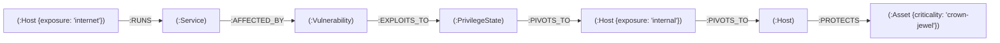

# ThreatGraph Data Model & Schema Specification

## Overview
ThreatGraph models network security topology, vulnerabilities, attacker privilege escalation states, and critical assets as a directed graph in Neo4j.

---

## 1. Node Labels & Properties

### `(:Host)`
Represents an IP-addressable machine on the network.
- `ip` (STRING, Unique): IP address on the subnet (e.g. `"10.10.10.10"`).
- `hostname` (STRING, Optional): Hostname or container name.
- `exposure` (STRING): `'internet'` or `'internal'`.
- `status` (STRING): `'up'` or `'down'`.

### `(:Service)`
Represents a network service listening on an open port of a host.
- `id` (STRING, Unique): Unique identifier formatted as `{ip}:{protocol}:{port}` (e.g. `"10.10.10.10:tcp:80"`).
- `port` (INTEGER): Port number (e.g. `80`, `22`, `5432`).
- `protocol` (STRING): Transport protocol (`"tcp"` or `"udp"`).
- `name` (STRING): Service name (e.g. `"http"`, `"ssh"`, `"postgresql"`).
- `product` (STRING): Detected software product (e.g. `"Apache httpd"`, `"OpenSSH"`, `"PostgreSQL"`).
- `version` (STRING): Product version string (e.g. `"2.4.49"`).

### `(:Vulnerability)`
Represents a known, publicly cataloged security flaw affecting a service.
- `cve_id` (STRING, Unique): Official CVE identifier (e.g. `"CVE-2021-41773"`).
- `title` (STRING): Vulnerability description/title.
- `cvss` (FLOAT): CVSS base score between 0.0 and 10.0 (e.g. `9.8`).
- `epss` (FLOAT): Exploit Prediction Scoring System probability between 0.0 and 1.0 (e.g. `0.94`).

### `(:PrivilegeState)`
Represents the execution context or access level achieved by exploiting a vulnerability or pivoting.
- `id` (STRING, Unique): Unique identifier (e.g. `"priv-daemon-web"`).
- `level` (STRING): Privilege tier (e.g. `'user'`, `'root'`, `'service'`).
- `description` (STRING): Description of access (e.g. `"RCE execution as daemon"`).

### `(:Asset)`
Represents a high-value business or system target protected by the environment.
- `id` (STRING, Unique): Unique asset identifier (e.g. `"asset-db-01"`).
- `name` (STRING): Human-readable name (e.g. `"Customer Records Database"`).
- `criticality` (STRING): Business criticality level (e.g. `'crown-jewel'`).

---

## 2. Relationships (Edges)



| Relationship | Source Label | Target Label | Description |
|---|---|---|---|
| `RUNS` | `Host` | `Service` | Indicates that the host has this service active and listening. |
| `AFFECTED_BY` | `Service` | `Vulnerability` | Maps a service product/version to a known CVE vulnerability. |
| `EXPLOITS_TO` | `Vulnerability` | `PrivilegeState` | Indicates the access level granted upon successful exploitation. |
| `PIVOTS_TO` | `PrivilegeState` / `Host` | `Host` | Represents network reachability and lateral movement capability. |
| `PROTECTS` | `Host` | `Asset` | Designates the host as the custodian storing or protecting an asset. |

---

## 3. Idempotent Ingestion Rule
All nodes and relationships must be written using Cypher `MERGE` clauses with unique keys to guarantee idempotency across multiple scan cycles:
```cypher
MERGE (h:Host {ip: $ip})
MERGE (s:Service {id: $service_id})
MERGE (h)-[:RUNS]->(s)
```
